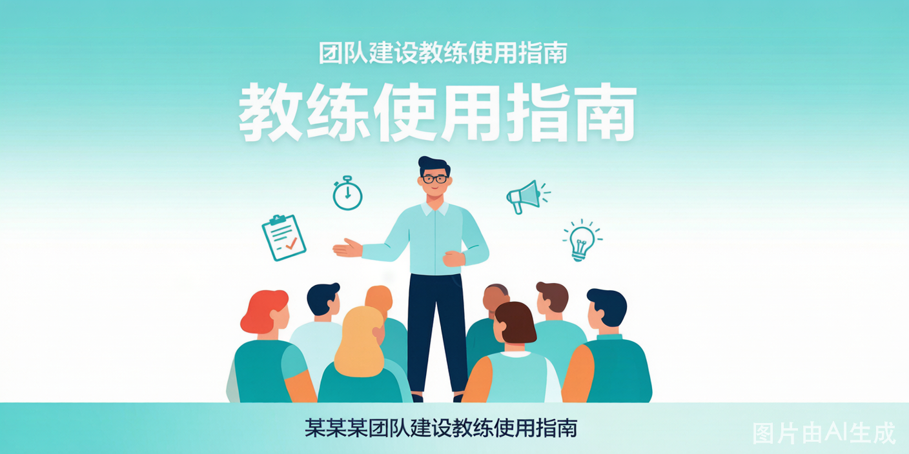
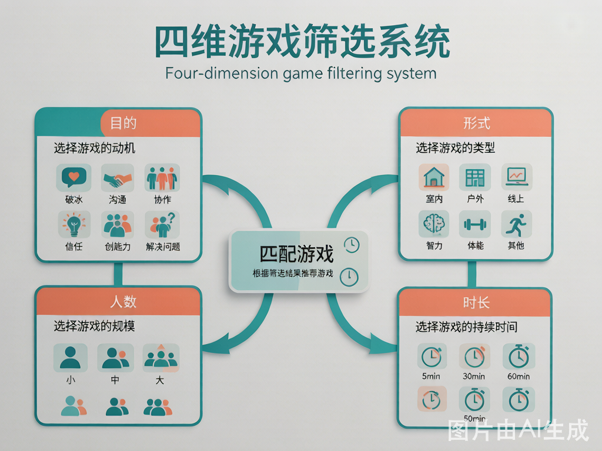
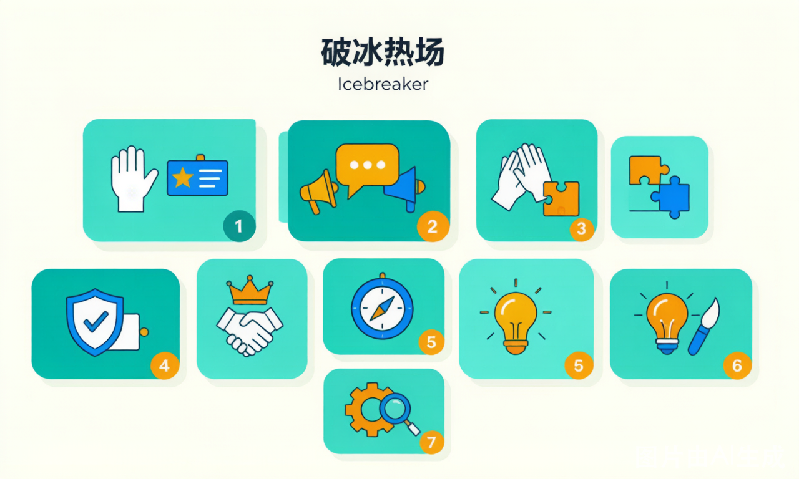
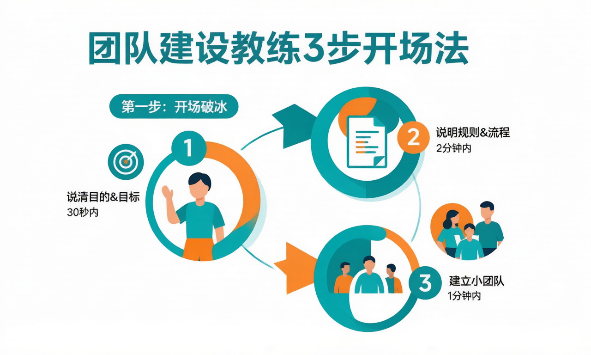
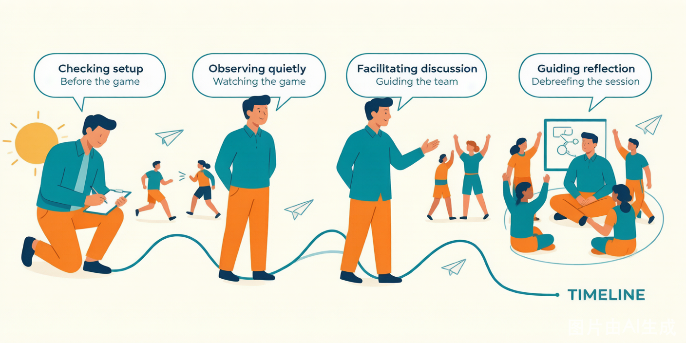
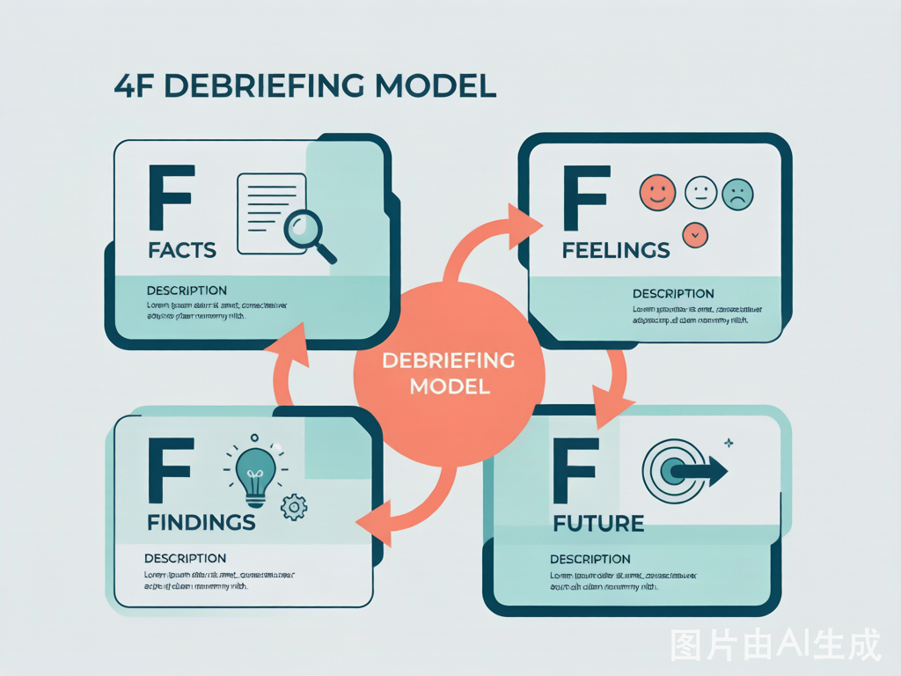

# 教练 / 培训师使用指南

> **一句话**：第一次带团建，从这一页开始——5 分钟读完，你就知道该选哪个游戏、怎么开场、怎么收尾。

这一页不介绍具体游戏，只解决三件事：**怎么选**、**怎么带**、**怎么收**。具体规则都在游戏详情页里。

---

## 一、怎么选游戏

选游戏不是「找一个好玩的」，而是**用四个条件把 101 款砍到 3 款**。按这个顺序问自己：

| 维度 | 你要先知道什么 | 为什么排在最前面 |
|------|--------------|-----------------|
| **时长** | 这段活动你实际有多少分钟 | 时长不够，再好的游戏也只剩半截；多数翻车都是超时 |
| **人数** | 全场多少人，能分几组 | 决定是「全员一起」还是「多组并行」 |
| **场地** | 室内 / 户外 / 线上，有没有桌椅 | 决定能不能跑动、能不能蒙眼、会不会吵到别人 |
| **目标** | 这次想解决什么（破冰？协作？复盘？） | 决定选哪个分类，也决定复盘往哪儿问 |

**回答完这四个问题，去首页筛选**：搜索框下面的「人数」「时长」两行是常驻的，场地和能力收在「更多筛选」里。选完剩下的卡片，就是你的候选池。

### 选游戏的三条原则

- **时间宁短勿长**：留 20% 缓冲，别把流程排满。一场 3 小时的活动，实际有效时间通常只有 2 小时 20 分。
- **人数宁少勿多**：大组一定要拆成多个小组并行。30 人挤在一个游戏里，一定有 10 个人在玩手机。
- **难度宁浅勿深**：规则能在 2 分钟内讲清楚最好。讲规则超过 3 分钟，参与者的耐心就已经用掉一半了。

### 一个具体的例子

> 周五下午，30 人，公司会议室，想让最近有点闷的团队松一松。

- 时长：3 小时（实际可用 2.5 小时）
- 人数：30 人 → 分 5 组，每组 6 人
- 场地：室内会议室，桌椅可以挪开，但不能跑跳、不能吵闹
- 目标：破冰 + 轻协作，不挖深情绪

筛选结果：破冰类选[人类宾果](games/icebreaker/human-bingo.html)（15 min，零道具，全员走动），协作类选[齐眉棍](games/collaboration/eyebrow-stick.html)（20 min，站着就能做，安静）或[画图接龙](games/communication/drawing-relay.html)（25 min，坐着也能做），收尾用[4F 复盘](toolbox/debrief.html)（20 min）。

完整排法可以直接抄[半日团建模板](flows/half-day/01-schedule.html)。

---

## 二、怎么带游戏

### 开场三步法

**第一步：说目的（30 秒）**

> 「今天我们玩这个游戏，是想让大家体验一下______。」

先说价值，再讲规则。参与者知道「为什么要玩」，投入度会明显不一样。填空处直接抄游戏详情页里的「团建核心价值」。

**第二步：讲规则（2 分钟）**

- 只讲核心规则。变体、细节、特殊情况，等第一轮结束后再补。
- 一定要**示范**：找两个人当场演一遍，比说十句管用。
- 讲完不要问「大家听懂了吗」——所有人都会点头。改成：**「小王，你说一下你等会儿要做什么。」**

**第三步：定分组（1 分钟）**

- 提前想好分组方式，别在现场数人头。五种常用分组法见[物资与效率](toolbox/checklist.html)。
- 有意识地**打散**：同部门的人坐一起会互相掩护，跨部门混编才有信息流动。
- 宣布开始后，教练立刻退后。你站在圈子中间，游戏就变成了「你的课」。

### 游戏进行中，教练在做什么

| 阶段 | 教练在做什么 | 最容易犯的错 |
|------|-------------|-------------|
| **开始前** | 检查场地安全、道具就位、分组完成 | 忙着招呼人，忘了看地面滑不滑 |
| **规则讲解** | 说目的、讲规则、做示范、确认理解 | 讲太多变体，把参与者讲晕 |
| **第一轮进行** | 退后观察，记录关键时刻（谁在指挥、谁在沉默） | 忍不住出声指导 |
| **卡住 / 混乱时** | 判断是「有价值的挣扎」还是「无意义的混乱」 | 太早介入，把最有价值的素材填掉了 |
| **即将结束时** | 提前 2 分钟预警，让团队有时间收尾 | 突然喊停，情绪断在半空 |
| **结束后** | 立刻进入复盘，趁情绪还在 | 先休息 10 分钟，回来什么都不剩了 |

**一条判断标准**：如果团队在**努力但没成功**，别管；如果团队在**等你说下一步**，该介入了。

### 三种常见现场状况

| 状况 | 怎么处理 |
|------|---------|
| **全场冷场，没人说话** | 不要催。先自己下場参与一轮，或者点名问一个具体的人一个具体的问题（「你觉得第一步该干什么」），不要问「大家有什么想法」 |
| **一个人全程指挥，别人不听** | 不介入。记住这个人，复盘时问「刚才谁在指挥？他的话为什么没被采纳？」——这一问比现场纠正有效十倍 |
| **有人明显不在状态（玩手机、站角落）** | 走过去，给一个具体的小任务（「你帮我看时间」「你负责记录」），不要问「你怎么不玩」 |

更多话术见[引导话术库](toolbox/facilitation.html)。

---

## 三、怎么复盘

**复盘不是总结。** 总结是「今天我们学到了团队合作很重要」，复盘是「刚才第 12 分钟，你为什么没有把那块板子换给第三组」。

### 4F 模型

| 层次 | 问什么 | 典型问句 |
|------|-------|---------|
| **Facts（事实）** | 刚才到底发生了什么 | 「你们组做了什么？没做什么？」 |
| **Feelings（感受）** | 当时什么感觉 | 「那一刻你是什么感受？紧张？兴奋？沮丧？」 |
| **Findings（发现）** | 学到了什么 | 「这和工作中的什么情况相似？」 |
| **Future（行动）** | 接下来做什么不同的事 | 「回到工作，你会做一件什么不同的事？」 |

**顺序不能乱。** 跳过 Feelings 直接问 Findings，得到的一定是场面话。

### 复盘话术模板

**开场（30 秒）**：

> 「我们先不评价做得对不对。先花两分钟，把刚才发生的事捋一遍——你们组做了什么，卡在哪儿，谁做了什么。」

**Feelings（感受）**：

> 「球掉的那一刻，你脑子里第一句话是什么？」
> 「有人一直指挥但没人听的时候，你是什么感受？」
> 「最后成功那一下，你是松了一口气，还是有点意外？」

**Findings（发现）**：

> 「如果重来一次，你们会在**前 5 分钟**做什么不同的事？」
> 「这个游戏和你们上周那个项目，有什么相似的地方？」
> 「刚才谁说的话其实是对的，但当时没人听？」

**Future（行动）**：

> 「回到工作，接下来一个月你会做一件什么不一样的事？具体到跟谁、在什么场合、说什么话。」

不合格的回答是「我要多沟通」。这时候追一句：「跟谁？在哪个会上？第一句话说什么？」

### 复盘时间给多少

| 活动时长 | 复盘时长 | 说明 |
|---------|---------|------|
| 15 min 以内 | 5 min | 只做 Feelings + Findings，别硬凑四层 |
| 20–40 min | 10–15 min | 完整 4F，但 Findings 多给一点时间 |
| 40 min 以上 | 20–30 min | 4F + 全体分享，教练可以写白板 |
| 半天及以上 | 30–45 min | 加一轮「每人一句行动承诺」 |

详细的提问清单、四种常见卡点怎么破，见[复盘引导框架](toolbox/debrief.html)。

---

## 四、常见场景怎么排

不知道从哪儿开始时，直接抄这些组合：

| 场景 | 推荐排法 |
|------|---------|
| **新员工入职培训 · 破冰** | 破冰游戏（15 min）→ 协作游戏（30 min）→ 复盘（10 min） |
| **管理层领导力工作坊** | 领导力游戏（45 min）→ 深度复盘（30 min）→ 行动承诺（15 min） |
| **销售团队激励团建** | 热身（10 min）→ 合作游戏（40 min）→ 减压游戏（20 min）→ 复盘（15 min） |
| **跨部门协作（部门墙明显）** | 见[跨部门协作方案](flows/cross-dept/01-schedule.html)，半天，必须打散重组 |
| **新人第一个月融入** | 见[新人融入方案](flows/onboarding/01-schedule.html)，2–3 小时，重点是「被记住」 |
| **线上远程团队凝聚** | 线上破冰（15 min）→ 线上协作游戏（30 min）→ 线上复盘（10 min），见[线上团建模板](flows/online/01-schedule.html) |
| **全天团建活动** | 破冰（30 min）→ 主体活动 ×2（各 60 min）→ 午餐 → 大型合作挑战（90 min）→ 复盘总结（30 min），见[一日团建模板](flows/one-day/01-schedule.html) |

---

## 五、给新手教练的五条建议

1. **第一次带某个游戏，自己先玩一遍。** 找两三个同事试跑，你会发现规则里有一半的坑是文字看不出来的。
2. **准备 Plan B。** 冷场、超时、道具坏了、有人受伤——每个都要有替换方案，写在流程卡的背面。
3. **控制自己的表达欲。** 说得越多，参与者的体验越少。教练的最高境界是「在场但不占场」。
4. **每次带完写三行复盘。** 哪个环节超时了？哪句话让全场安静了？下次改什么？攒十次，你就有自己的经验库了。
5. **提前跟客户确认三件事**：人数会不会变、有没有人不能参与体力活动、场地能不能挪桌椅。这三件事任何一件变了，流程都要重排。

---

## 六、下一步

- **要选游戏** → 回[首页](index.html)，用人数、时长、场地筛选
- **要现成流程** → [一日模板](flows/one-day/01-schedule.html) / [半日模板](flows/half-day/01-schedule.html) / [领导力工作坊](flows/workshop/leadership-awakening.html)
- **要话术** → [引导话术库](toolbox/facilitation.html)
- **要物资清单** → [物资与效率](toolbox/checklist.html)
- **要安全预案** → [安全与管理](toolbox/safety.html)

---

_最后更新：2026-11-02_
